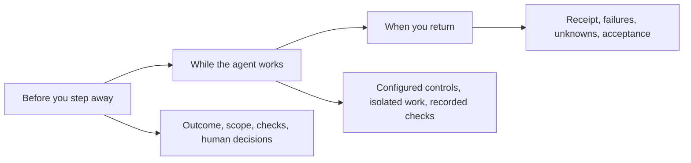
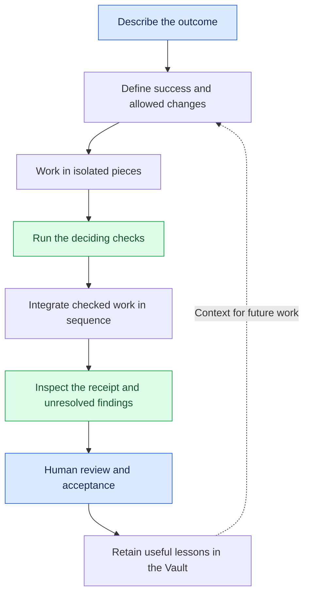
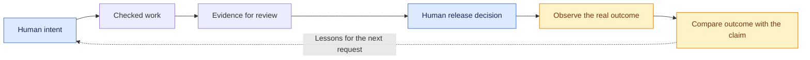
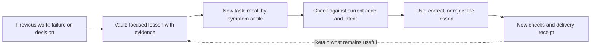

# Brother

## Start in sixty seconds

### Claude Code

```bash reference
claude plugin marketplace add khalilmaaouni/Brother && claude plugin install brother@brother
```

Open a repository and type `/brother`, followed by the outcome you want. For example:

```text
/brother make add() reject non-numeric input and prove the behavior with a test
```

With no unfinished work, Brother asks what you are trying to do. If work is unfinished, it can find it by its outcome and offer to resume it. For installation, update, and removal instructions, see [Install on Claude Code](docs/how-to/install-claude-code.md).

### Cursor

From a Brother checkout, install the local plugin:

```bash reference
python3 scripts/cursor_plugin_install.py
```

Reload the window, then invoke `/brother`. See [Install on Cursor](docs/how-to/install-cursor.md). Cursor's limits remain advisory until a signed-in session demonstrates that an action outside the allowed scope is blocked.

### Codex

Install the Brother plugin and configure its supported managed hooks. Then use the installed Brother skill or run the engine from a Brother checkout. See [Install on Codex](docs/how-to/install-codex.md).

To upgrade an existing install, remove the configured marketplace first, then add it again at the new ref, joined so no step runs over a failed one:

```bash reference
codex plugin marketplace remove brother && codex plugin marketplace add https://github.com/khalilmaaouni/Brother --ref <new ref> && codex plugin add brother@brother --json
```

### Let AI work. Give it boundaries. Make it earn your trust.

**When AI says done, Brother gives you proof.**

Brother connects scoped execution, verification, delivery evidence, and local memory. It helps you define the outcome, check the work, and review what happened. Protection depends on the installed controls, the task, and the quality of its checks. Brother does not guarantee that every task is safe to leave unattended.

[Who Brother is for](#who-brother-is-for) · [Why this approach](#why-brother) · [The Vault](#the-vault-remember-the-lesson-not-just-the-conversation) · [Documentation](docs/README.md)

**Start small:** [try a verified change](docs/tutorials/first-verified-change.md), then use the [delegation checklist](docs/how-to/delegate-safely.md) before increasing autonomy. For help choosing a workflow, see [What you can do with Brother](docs/explanation/what-you-can-do-with-brother.md) or [Where Brother fits](docs/explanation/choosing-a-workflow.md).

## What changed in 1.1.9

1.1.9 is a recovery release for the cut process, with a faster hook dispatcher and a measured account of what a fresh install can do.

The cut records each attempt outside the candidate and can resume from the failed phase. Reuse requires matching inputs; an unknown input never counts as a match. Approval is checked early and spent once when the candidate is ready. One coordinator holds the lock while refreshing a login. If renewal cannot complete, the attempt parks. Tests: `python3 -B scripts/test_cut_resume.py`, 14 cases OK on both interpreters. Both rehearsals ran on the real host and are recorded in `docs/plan/CUT-REHEARSAL-1.1.9.json`: the cold rehearsal of the cut took 7781 seconds (preflight 1015, check 6766); the failure and resume rehearsal failed late after the same expensive phases (6996 seconds), and its resume reused the preflight and the check and repeated no expensive execution. The host had 12.87 GiB free, under the 15 GiB default floor, and the rehearsal ran with the floor named at 12 GiB in the command; the record says so.

If a tag push fails after the tag reaches the remote, recovery checks the exact commit reported by this export. It does not adopt a foreign tag or create the tag twice. A publish record that cannot be written returns FAIL. Tests: `python3 -B scripts/test_cut.py`, 205 tests OK; the cut mutation sweep left no survivors among 11 mutations.

One shell tool event now starts one hook dispatcher process, down from six. On a fresh install, the independent seat's probe read one process per event with a median of 64 ms, against the 312 ms measured for v1.1.4. The first goal journey's hook cost row reads PASS. Reproduce the journey with `BROTHER_JOURNEY_WALKED_BY=<seat> python3 -B scripts/journey/run_journey.py --fresh-install --journey J2`.

Fresh install checks cover the install, first goal, and review and accept journeys. The first goal has five PASS rows; review and accept has three. Install has one PASS row and four NO-DATA rows. The independent scores are install 2 of 10, first goal 10 of 10, and review and accept 6 of 6. These are scores for the named checks, not a rating of the whole product. `python3 scripts/go_no_go_119.py` reads eight release rows and reports the measured scores. Its required work row reads the plan; an empty required list needs a recorded decision.

Repository sessions have short notes at the root, loop, and bundle. The root imports the repository instructions once. Export checks identify the public tree from its own project record. Tests: `python3 -B scripts/test_notes.py`, 9 tests OK. Work moved to a later release keeps its frozen check owned through the plan's move record; verify with `python3 -B scripts/test_bl_owns_complete.py`.

The release target is `v1.1.9`, with manifests reading `1.1.9`. The tag ships an export manifest at `docs/releases/1.1.9.export-manifest.txt`, naming every exported file with its sha256. After publication, a fresh clone can verify the exported files without private access or a network connection: check out `v1.1.9`, then run `python3 scripts/reproduce_export.py --verify-tree --tag v1.1.9`. PASS means the named files match their recorded hashes; missing evidence reads NO-DATA.

Not verified in this release: four install checks remain NO-DATA, covering the first screen's paths, internal names, repair through the doctor, and execution of the README's claims. They are recorded as deferred work. The loop token lane reports RENEWED when the login holder answers, not when the provider accepts the login; a seat whose login fails parks. This does not establish automatic renewal. The named checks do not prove that an arbitrary task can finish unattended, that every feature is accessible, or that every branch of the code is covered.

## What changed in 1.1.8

1.1.8 is the release where every delivery report names what was checked and what that proves, and where the Vault refuses to let an author approve their own candidate.

Every delivery report ends with one receipt sentence per unit, the acceptance screen line and, where a risk class was named, the release screen line. It also carries the scoping sentence: `exit 0 means no check failed. It does not mean everything is proven: only the checks named above ran, and a check nobody wrote cannot fail.` Tests: `python3 scripts/test_receipt_door.py`, at 252 OK.

Each wait during a run prints one governor line when it starts and one when it ends. It does not print another line on every poll, so the wait's start and finish are reported without repeating the same notice while it continues. Tests: `python3 scripts/test_brother_run.py`, at 286 OK.

Before an edit of a file the Vault knows, the recall hook prints `Recalled N lesson(s) from the Vault for <file>`. A genuine no-match prints nothing, and the hook writes nothing before consent. Tests: `python3 products/brothermode/tools/test_vault_recall_hook.py`, at 83 OK.

Vault promotion requires a separate approver. An author cannot approve the same candidate, and the rule is on by default: `SEPARATION_OF_DUTIES_ENFORCED` is `True`. Turning that flag off makes the tests for refusing the same author and approver fail, including the case where no enforcement argument is supplied. Tests: `python3 products/brothermode/tools/test_bm_vault_lifecycle.py`, at 42 OK.

The promote command and the approval pane apply the same rule. The refusal of an author's own approval is checked through both paths. Tests: `python3 products/brothermode/tools/test_bm_vault_promotions.py`, at 27 OK, and `python3 products/brothermode/tools/test_bm_vault_pane.py`, at 12 OK.

The 15 legacy command shims remain in this cut, per decision D2.

The public cut is tagged `v1.1.8`, and its manifests read `1.1.8`. The tag ships an export manifest at `docs/releases/1.1.8.export-manifest.txt`, naming 4663 exported files with a sha256 for each. Every file it names ships in the tag. Files under `docs/releases/` are outside the digest, because the release note carrying the digest cannot also be hashed by it.

A fresh clone can check the exported tree with no private access and no network. After `git checkout v1.1.8`, run `python3 scripts/reproduce_export.py --verify-tree --tag v1.1.8`. It prints PASS when every named file matches its recorded hash, FAIL with each file that does not, and NO-DATA when the manifest or digest is missing. The source revision in the release note belongs to the private hub and cannot be resolved from the public clone; the public tag and manifest digest are the checkable claims.

The release note's file checks were measured by breaking each listed file's functions, running the named suite and requiring it to fail, then restoring the file and checking its hash byte for byte. Where a claim's own suite did not catch a broken file, the table names the suite that did. Re-run the table with `python3 scripts/release_note_perturb.py --version 1.1.8`.

Not verified in this release: the file checks do not prove that every branch is covered. They show that replacing a file's functions with ones that raise is noticed by the named suite. A file no suite catches is reported as NO-DATA. A passing delivery report proves only the checks it names ran without a failure; it does not prove behavior for which no check was written.

## What changed in 1.1.7

1.1.7 is the release where a skipped test can no longer pass as done, and where the loop's own tools and judge cannot change without a whole gate, a canary and, for the judge, the owner's code.

A builder or loop seat reports DONE through one proof only: the boxed done check run by `close_unit`. A skipped test reads PARTIAL, never DONE, and before DONE a preflight runs five integration lints over the lane. Tests: `python3 -B scripts/test_builder_preflight.py`.

The deployed loop judges its own next generation. A landing that changes a loop tool deploys only after a boxed whole gate and a canary pass, and a changed judge file stays pending until the owner approves it with a code. On 2026-10-21 the loop landed a real change end to end through the live deploy step; the judge's boxed whole gate read 63 rows with 0 failed and 0 no data. Tests: `python3 -B scripts/test_land_batch_loop_guard.py`.

Every loop launch arms a watcher beside the driver. It announces a stuck run, an unexplained hold or a dead driver once per cause, with a desktop notification and an alarm record in the run folder. It does not stop the run and cannot wake a Claude Code session. Before the driver starts, a landing canary sends one small change through the deployed judge, and the launch refuses unless the canary prints its landing line. Tests: `python3 -B scripts/loop/test_run_watch.py TestRunWatch`, `python3 -B scripts/loop/test_landing_canary.py TestLandingCanary`.

The loop report names suites that went red without any code change. Records that expire on a date make a launch refuse early and name the stale record. Tests: `python3 -B scripts/loop/test_loop_works_fully.py TestLoopWorksFully`, `python3 -B scripts/loop/test_clock_rows.py TestClockRows`.

The installed copy of the loop ships the adapters package its model tools import, and `scripts/loop_alone.py` imports every installed loop tool alone. The redeploy check (`scripts/loop/redeploy.sh`) refuses to run its live seat probe without a positive spending cap, `--probe-cap-usd`. Tests: `python3 -B scripts/test_loop_alone.py`, `python3 -B scripts/loop/test_redeploy_check.py`.

A run's receipt names the unit it landed, its branch and its revision. A run pushes only when it is DONE with an accept recorded on the release screen, so a rejected review pushes nothing. Test: `python3 -B scripts/test_receipt_door.py`.

The cut rehearsal keeps its commits and records the exact tip it proved; a real cut must resume from that tip, and a cold cut needs the owner to say so. The phone approval of the cut that 1.1.6 shipped is now live: the 1.1.7 cut ran only on the owner's six digit codes, each tied to the version and commit. The whole gate checks the committed kernel list against the code, in the private hub only. Tests: `python3 -B scripts/test_cut_keeps_rehearsal.py`, `python3 -B scripts/test_kernel_closure_row.py TestKernelClosureRow`, `python3 -B scripts/test_cut_preflight.py`.

The private terms scan reads escaped and split terms, and no test spells the scratch folder's path any more. Tests: `python3 -B scripts/test_private_terms_escapes.py`, `python3 -B scripts/test_runs_root_one_rule.py`.

Not verified in this release: the unattended run that closed the proof lasted about 20 minutes and landed one sub unit, then stopped itself because nothing else in scope was open; 52 planned units are deferred to later releases. Three units have every sub unit landed but stay open, because their done checks pass with skipped tests and the closer counts a skipped test as not a pass. The loop did not land the proof work untouched: hand repairs were made to the release line during the proof runs. Two cases of `scripts/loop/test_land_apply.py` still fail, as in 1.1.6: `native_worker.py` became a path a build may not write, and the test still assumes a build can edit it. `scripts/loop_alone.py` follows a tool's import only up to the first error that is not a missing module, so a tool that does work at import time (12 of 99) is counted as neither loaded nor a problem. The grader's sandbox needs the real git binary first on PATH; the launch scripts provide it, not the grader itself. Login holding, expiry warnings before a login lapses, the seat gate, relaunch without an operator and an eight hour signed in soak are deferred, and no 24 hour qualifying run was done. The phone code gates the cut command, not every route to a tag: closing the route by which a session holding the maintainer's GitHub login could push a tag directly is planned, not shipped.

## What changed in 1.1.6

1.1.6 is the release where the cut learns to take its approval from your phone, and where a night of the loop is read back from its own ledger instead of from memory.

The cut accepts an approval line with a six digit code from an authenticator app, checked against the exact version and commit, and refuses when the key id pinned in the repository is missing or reads NOT-ENROLLED. The owner's one time enrollment is still pending, so this approval path is not live until the key id pull request is merged. Tests: `python3 -B scripts/loop/test_brother_approve.py`, `python3 -B scripts/test_cut_app_approval.py`.

When the disk runs low, one command lists the worktrees that are clean, pushed, idle for over 24 hours and unleased, and removes them without ever forcing; a leased worktree or one holding an ignored file is refused by name. The cut fetches in its own worktree and does not write into the shared checkout. Every builder branch can carry a precheck record with PASS, FAIL or NO-DATA per row. The deployed program finds its own code root from the deploy stamp or refuses by naming the folder to run from. Tests: `python3 -B scripts/test_worktree_prune.py`, `python3 -B scripts/test_cut_never_writes_shared_checkout.py`, `python3 -B scripts/test_branch_precheck.py`, `python3 -B scripts/loop/test_code_root_from_bin.py`.

The whole gate now includes the landing call site suite and refuses the row being absent. Its ledger accepts a row outside a cut, so a hand run appends rows instead of refusing them. The push check (`scripts/pre_push_gate.py`, asking `gate_ledger.whole_gate_pass_in_repo`) accepts the newest recorded whole gate pass when the delta from its tree is only markdown under `docs/plan/specs/` or `docs/plan/seeds/`; any other byte needs a record of its own. Tests: `python3 -B scripts/test_required_fast_rows.py`, `python3 -B scripts/test_gate_ledger_cut_id.py`, `python3 -B scripts/test_whole_gate_docs_delta.py`.

A reader, `scripts/loop_phase_timings.py`, run by hand over the logs the loop already writes, prints a timing row for each phase of launch, run, land, close and cut, with null seconds and a reason when a source is unreadable; no loop script calls it, and its first run over the night found two defects now logged for 1.1.7 (a UTC run start read against local clock lines, and close and gate rows that read NO-DATA because those writers print no duration). The loop's run summary takes the state word from the ledgers, shows cash as UNKNOWN when the money ledger is unreadable (never 0), and prints no review line when nothing landed. A new tool, `scripts/loop_budget_grant.py`, writes a stated budget into the spend guard as a time boxed project raise, never as the global override; nothing in the loop calls it yet, so a loop launch still does not write your budget. On the night of 2026-10-18 the loop landed 4 of the 4 units it admitted, with 0 seat waits and 0 timeouts in 16 attempts, and that reading is recorded from the ledger. Tests: `python3 -B scripts/test_loop_phase_timings.py`, `python3 -B scripts/loop/test_run_summary_state.py`, `python3 -B scripts/test_loop_budget_grant.py`, `python3 -B scripts/test_donecheck_116.py`.

Export and hermetic check directories use the one scratch root and are removed at the end, and a folder the path finder cannot read is named instead of skipped. A commit that touches `scripts/`, `plugin/`, `bundle/` or `products/` regenerates the runtime mirror, and a generator failure refuses the commit. Tests: `python3 -B scripts/test_export_scratch_root.py`, `python3 -B scripts/test_self_check_bundle_runtime.py`.

The Codex record runs each finished unit's done check through a Codex run: 19 units, PASS 18, FAIL 0, NO-DATA 1. A README section is now required for every release note from 1.1.0 upward, and the 1.1.7 seed register lists the measured slow phases and every issue found with its root cause and test unit. Tests: `python3 -B scripts/test_hosts_116.py`, `python3 -B scripts/test_readme_changed_sections.py`, `python3 -B scripts/test_seed_117.py`.

Not verified in this release: the owner's approval enrollment is not done, so the app approval path is not live. The Codex row for the approval verifier reads NO-DATA because 11 of its cases do not run inside the sandbox. Cost per landing, the notify request rows and relay times, the next action bar, and the run and close phase seconds read NO-DATA for the night. No 24 hour qualifying run was done. The login hold, the seat gate, the mid run seat loss handling, the expiry warning and the ignored file overwrite refusal are not in 1.1.6; the login hold code is in the tree but nothing starts it.

## What changed in 1.1.5

1.1.5 is the Brother.loop release: an unattended night should end with what landed, what is stuck and the one thing to do next, without anyone relaying it.

A check that is red on both the unchanged copy and the built copy is named as an environment defect and the build is held, never charged or parked for it. Tests: `python3 -B scripts/loop/test_land_apply_baseline.py`, `python3 -B scripts/loop/test_land_batch_env_hold.py`.

A landing that changes the loop's own tools runs the deploy's own freeze closure and tool parity before it commits, and is then held for the session's whole gate: the loop never certifies a change to its own governance. A push that changes a loop file needs a whole-gate PASS record for exactly the pushed tree. Tests: `python3 -B scripts/loop/test_land_batch_closure.py`, `python3 -B scripts/loop/test_land_batch_whole_gate.py`, `python3 -B scripts/test_whole_gate_record.py`, `python3 -B scripts/test_pre_push_whole_gate.py`.

Stuck units come back on their own: the diagnostician runs from a stamp verified frozen copy, a diagnosis note written during an attempt counts for the next one, and a pass that is only waiting on a cooldown waits instead of stopping the run. Refusal text reaches the next worker only as fenced, untrusted data. Tests: `python3 -B scripts/loop/test_diag_frozen_root.py`, `python3 -B scripts/loop/test_runner_pool_note_attempt.py`, `python3 -B scripts/loop/test_unproductive_cooldown.py`, `python3 -B scripts/loop/test_brief_untrusted_notes.py`.

One redeploy command checks every deploy and launch refusal before anything is stopped, and the launcher names its remedy (which program is signed in, plug in the charger). Each run writes a summary with one state word and one next action after every pass and at its end, and every landing line shows OpenRouter cash and the Claude plan share. Tests: `python3 -B scripts/loop/test_redeploy_check.py`, `python3 -B scripts/loop/test_start_run_remedy.py`, `python3 -B scripts/loop/test_run_summary.py`, `python3 -B scripts/loop/test_usd_plan_share.py`, `python3 -B scripts/loop/test_loop_golden_journeys.py`.

Not verified in this release: a 24 hour qualifying run, and the night's own loop run, which could not start because the Claude sign in had expired.

## What changed in 1.1.4

Every delivery report ends with one receipt sentence per unit, the acceptance screen line and, when a risk class was named, the release screen line. It also states that exit 0 means no check failed, not that everything is proven. Test: `python3 -B scripts/test_receipt_door.py`.

Each wait during a run prints one governor line when it starts and one when it ends, never once per poll. Test: `python3 -B scripts/test_brother_run.py`.

Before an edit to a file known by the Vault, the recall hook prints the lessons recalled. It prints nothing for a genuine no-match and writes nothing before consent. Test: `python3 -B products/brothermode/tools/test_vault_recall_hook.py`.

Vault promotion enforces separation of duties: an author cannot approve the same candidate. The promote command and approval pane apply the same rule. Tests: `python3 -B products/brothermode/tools/test_bm_vault_lifecycle.py`, `python3 -B products/brothermode/tools/test_bm_vault_promotions.py`, `python3 -B products/brothermode/tools/test_bm_vault_pane.py`.

The 15 legacy command shims remain in this release.

## What changed in 1.1.3

Fast cut reuses each row receipt only when its bytes match, and one resumable driver prints a line for each phase, never pushes, and leaves the release question unanswered. A stopped cut leaves the release branch at the candidate; step 2b runs in parallel clones, and the Linux verdict checks the exact export tree before the question. Tests: `python3 -B scripts/test_cut_receipts.py`, `python3 -B scripts/test_cut_driver.py`, `python3 -B scripts/test_cut_preflight.py`, `python3 -B scripts/test_perturb_pool.py`, `python3 -B scripts/test_linux_canary.py`.

Loop start names the real cause when a model seat is unavailable, times every launch step and prints the total, and refuses a battery launch before slow work. Intake checks run in parallel, content keyed gates are cached, and the READY list cannot be truncated. One maintainer machine measurement on 2026-10-12 took 79 s from command to first claimed unit. Tests: `python3 -B scripts/loop/test_seat_refusal_line.py`, `python3 -B scripts/loop/test_start_run.py`, `python3 -B scripts/loop/test_intake_parallel.py`, `python3 -B scripts/loop/test_loop_gate_cache.py`, `python3 -B scripts/loop/test_ready_contract.py`.

Status, deliver and the engine's `receipt_door.py --verdict` command now read the same receipt verdict. Test: `python3 -B scripts/test_verdict_parity.py`.

Recovery diagnoses a stale packed-refs.lock and refuses with the exact human remedy, without deleting the lock. A killed run resumes without losing a unit or merging one twice. Tests: `python3 -B scripts/test_stale_lock_refusal.py`, `python3 -B scripts/test_kill_boundaries.py`.

Jev second opinions stay in shadow and do not change a verdict. Each check has a readout with measured agreement, review and deliver label second opinions, and the registry ships with installs or gives one NO-DATA reason. Tests: `python3 -B scripts/test_jev_status.py`, `python3 -B scripts/test_jev_door.py`, `python3 -B scripts/test_jev_public_install.py`.

Ask for an iPhone check in plain words to get the doctor, profile-init, reference-init and run sequence, ending in a simulator receipt. It uses simulated devices, and screenshots stay local. Tests: `python3 -B scripts/test_mobile_door.py`, `python3 -B scripts/test_mobile_profile_init.py`, `python3 -B scripts/test_mobile_xcode_canary_local.py`.

Memory now has one vault setting, `BROTHERMODE_VAULT_ROOT`, with the old names as aliases; two names pointing to two folders cause a refusal instead of a guess. Test: `python3 -B products/brothermode/tools/test_vault_resolver.py`.

Human acceptance binds to the exact receipt it accepts. A review skip records who skipped, why and when. Tests: `python3 -B scripts/test_acceptance_binding.py`.

Delivery shows all five assurance gates, not only numbers; an unrun gate reads `NO-DATA`. Test: `python3 -B scripts/test_assurance_matrix.py`.

Safe unwatched time stops at the first human intervention, and a run without capture reads as an upper bound. Test: `python3 -B scripts/test_sut_interventions.py`.

Host claims read certified, advisory or `NO-DATA` from re-parsed evidence. A host is not called enforced without a recorded denial. Test: `python3 -B scripts/test_host_evidence_binding.py`.

Escape attempts are measured per host, door overhead uses samples rather than one run, and benchmark controls refuse a ranking while anything is `NO-DATA`. Tests: `python3 -B scripts/test_escape_measure.py`, `python3 -B scripts/test_door_overhead.py`, `python3 -B scripts/test_bench_controls.py`.

Timing-sensitive tests are found and refused at the push. The battery runs in shards and only the rows a change reaches. Tests: `python3 -B scripts/test_timing_hunt.py`, `python3 -B scripts/test_check_all_merge.py`.

A failed public check is rerun once only when the same export tree already passed on Linux. A refused loop start gets a labelled second opinion that never changes the refusal. Tests: `python3 -B scripts/test_export_public.py`, `python3 -B scripts/test_jev_start_refusal.py`.

For the seven pain point pages, see [docs/pain-points/README.md](docs/pain-points/README.md).

## What changed in 1.1.2

A run that reports PASS beside NO-DATA now exits 2, meaning unverified. If its receipt cannot be written or read back, it exits 1. The result line and exit code now reflect the run’s whole delivery verdict.

Runs record their Work document in `target.json`, and continuity asks the engine to look up that document. When the pointer is doubtful, the run refuses with a reason. The loop now sends every READY build for a planned unit to the lander, while builds with no plan unit are counted but never offered.

The release rehearsal now keeps the machine awake from lock through recording, checks preflight before doing work, and reports the time for each cut step. The cut checks the version rule after the bump, tags the release pull request’s merge commit, and stops incomplete if a requested Release is missing. A manual dispatch job runs only on the private hub.

The Codex install guidance and skill wording are refreshed, and the host capability table distinguishes documented mechanisms from current certification, which remains NO-DATA without matching sealed evidence. Version pages are checked for promises about the version being cut, and the live tree is checked for stale sentences. The run evidence recorder and handover ceremony also improve how interrupted work and repeated lessons are handled.

## What changed in 1.1.1

Brother now has one door and seven skills: `using-brother`, the door, and `brother-start`, `brother-status`, `brother-next`, `brother-review`, `brother-deliver` and `brother-help`. In Claude Code, type `/brother <what you are trying to do>`; the six verbs are optional shortcuts. Every skill name from 1.1.0 still works for this release: it prints a one-line pointer to its new verb, then routes.

A session also starts quietly. In an established project, the start block that 1.1.0 printed before your first prompt (6,014 bytes, measured 2026-10-10 in a fixture) is now 281 bytes. Housekeeping nags, the progress page check, handover and forecast lines, no-drift reconciliation rows and Vault status lines are no longer printed; setup, first run, update, recovery, store health and needs-action lines still are. To bring the full block back, set `BROTHER_VERBOSE_START=1` in the environment that launches your host (`BROTHERMODE_MAINTAINER=1` also works; only the exact value `1` counts). The limits in [Limits before adoption](#limits-before-adoption) still apply.

## What changed in 1.1.0

Brother addresses the trust gap between delegating work and knowing whether the result stayed within scope and has evidence behind it. It aims to reduce the need to watch every action while leaving review and consequential decisions with you.

One plugin named `brother` replaces the three older plugins in the catalog, and its install line has no dependency on another catalog entry. Lesson recall can work in the one plugin when the Vault folder variables are set. The release proof is one completed unattended run of eight hours, not an endurance guarantee. For migration details, see [Migrate to the Brother plugin](docs/how-to/migrate-to-one-plugin.md). The older plugins `brothermode`, `brothersbe` and `brotherds` are retired from the catalog; pinned installs of `brothermode` and `brothersbe` still resolve. Claim verification, formerly `brotherds`, is not carried by the one plugin and remains experimental. The limits of 1.1.0 are listed in [Limits before adoption](#limits-before-adoption).

## What a receipt tells you

A completed run writes `receipt/receipt.json` inside its run directory and prints that path as its last line. The receipt names changed files, checks and their exact commands and exit codes, who wrote each check, the engine revision, and returned cost fields. If a field cannot be answered, the receipt says `NO-DATA` and why.

The verdicts mean:

| Verdict | Meaning |
| --- | --- |
| `PASS` | The evidence supports the stated claim. |
| `FAIL` | The evidence contradicts the stated claim. |
| `NO-DATA` | The available evidence does not establish either answer. |

A successful command is not proof by itself. A check that was already green, does not exercise the claimed behavior, or stays green when the implementation is reverted can be `NO-DATA`. A receipt makes evidence reviewable; it cannot make a weak check sufficient.

## Problems developers report, and how Brother handles them

The examples use the `/brother` entry point. In Codex, invoke the installed Brother skill with the same request. Sources are linked with each reported problem. Reddit sources were read through third-party archive snapshots; their counts and dates are snapshot data, not live Reddit measurements.

### “Done” without a test run

A developer described a regression suite whose failures were reported as passing in [issue #46940](https://github.com/anthropics/claude-code/issues/46940) (2026-04-12). Other reports in the research note describe checks that failed or were never run.

**Example:** A change breaks an existing case, but the closing message says the suite passed. The reviewer has to run it again to learn what happened.

**Type:**

```text
/brother fix the regression and show which checks ran after the change
```

**What Brother does:** The receipt records each changed file, check command, exit code, and verdict. A check that did not run or does not establish the claim remains `NO-DATA`. J102 and J063 are second-opinion checks in shadow, so their answers do not control the run.

**Evidence left:** The run receipt, with `PASS`, `FAIL`, or `NO-DATA` for the evidence. Rerun the listed checks when reviewing the result.

**Limit:** A receipt is not an independent audit, and a test can be poorly designed.

More: [The change says "done" without running the tests](docs/pain-points/done-without-running-tests.md).

### A small request expands into unrelated edits

A [Cursor forum report](https://forum.cursor.com/t/linear-cursor-cloud-agent-sonnet-4-5-makes-overly-broad-edits-touches-18-files-when-only-1-2-expected/165633) (2026-07-13) describes a copy button change that touched about 18 files, including unrelated cleanup.

**Example:** You ask for one button and its test, then get a large diff of formatting and type changes that are hard to review.

**Type:**

```text
/brother add the copy button and its test; only change the files needed for that behavior
```

**What Brother does:** Work can be defined with an objective, allowed writes, dependencies, and a deciding check. J117 audits scope in shadow. Scope enforcement depends on the active host and mode.

**Evidence left:** The receipt identifies changed files and their checks. Scope findings can help direct review, but the shadow answer does not itself block a write.

**Limit:** These controls are not an operating system sandbox. Cursor remains advisory until its signed-in canary demonstrates a deny.

### Unattended work stalls or burns through its plan

A report about a run pausing at a usage limit says it “kills productivity” for overnight work: [issue #35744](https://github.com/anthropics/claude-code/issues/35744) (2026-03-18). Other reports describe limits arriving sooner than expected, including [issue #38335](https://github.com/anthropics/claude-code/issues/38335) and [issue #16157](https://github.com/anthropics/claude-code/issues/16157). An archived [agent discussion](https://reddit.com/r/AI_Agents/comments/1srcerr) describes repeated work with rising token use and no visible failure.

**Example:** A long job retries the same step, loses constraints, or stops at a limit without a useful account of what finished.

**Type:**

```text
/brother <outcome>
```

For existing work, resume from a Brother checkout with:

```bash reference
python3 scripts/brother_run.py --continue --cwd "$TARGET_REPO"
```

**What Brother does:** Each run can be resumed from its recorded work. The receipt shows what changed and what checks ran. The Brother.loop release tooling is for Brother's own release plan; it is not a general-purpose overnight runner for other repositories. In 1.1.5 its landing tells an environment failure from a build failure, and every run writes a summary with a next action. In 1.1.7 every launch arms a watcher that announces a stuck run, an unexplained hold or a dead driver once per cause, and a landing canary must land one small change before the driver starts. Tests: `python3 -B scripts/loop/test_land_apply_baseline.py`, `python3 -B scripts/loop/test_run_summary.py`, `python3 -B scripts/loop/test_run_watch.py TestRunWatch`, `python3 -B scripts/loop/test_landing_canary.py TestLandingCanary`.

**Evidence left:** A receipt for completed work and the run state used to resume. Cost fields that the worker did not return are `NO-DATA`.

**Limit:** A cash budget for Claude seats is not established. A prior eight-hour run does not guarantee unattended operation.

More: [Headless sign-in lapses silently](docs/pain-points/headless-sign-in-lapses.md).

### Leaving it running overnight

People who leave a coding agent running report that it stops for reasons nobody sees until morning. Four public reports, each with what Brother.loop does about the same kind of failure:

- [Scheduled tasks need human intervention to run](https://github.com/anthropics/claude-code/issues/46312) (Claude Code issue 46312). Brother.loop's redeploy check prints every deploy and launch refusal before the drain, with the remedy: `python3 -B scripts/loop/test_redeploy_check.py`, `python3 -B scripts/loop/test_start_run_remedy.py`.
- [Scheduled tasks stop executing while the next run time keeps advancing](https://github.com/anthropics/claude-code/issues/85474) (Claude Code issue 85474). Each Brother.loop run writes a summary with one state word after every pass, and a run that died without its end step reads ABORTED: `python3 -B scripts/loop/test_run_summary.py`.
- [Long running tasks that are hard to trust and inspect](https://github.com/openai/codex/issues/45264) (Codex issue 45264). The summary sits in one file beside the run's log and names what landed, what is stuck and the next action: `python3 -B scripts/loop/test_run_summary_calls.py`.
- [Background agents that spend tokens without producing output](https://github.com/anthropics/claude-code/issues/69915) (Claude Code issue 69915). Every Brother.loop landing line shows both cost parts, OpenRouter cash and the Claude plan share: `python3 -B scripts/loop/test_usd_plan_share.py`.

### A scheduled run cannot answer a prompt

A report says scheduled tasks ask for folder and tool permissions again on each run: [issue #47180](https://github.com/anthropics/claude-code/issues/47180) (2026-04-13).

**Example:** A scheduled job waits for someone to approve a prompt that nobody sees.

**Type:**

```text
/brother <outcome>
```

**What Brother does:** The current intake checks whether the task can start with the available capabilities. If it cannot establish readiness, it reports the reason rather than treating a waiting process as completed work.

**Evidence left:** The intake result and, if work proceeds, the run receipt.

**Limit:** The specific sign-in warning and scheduled-run refusal improvements described in the plan are not part of this release.

More: [Scheduled runs prompt for permission every time](docs/pain-points/scheduled-runs-that-prompt.md).

### Constraints disappear as the conversation grows

A report says that “user intent and corrections” were lost after context compaction: [issue #36068](https://github.com/anthropics/claude-code/issues/36068) (2026-03-19). An archived discussion describes writing state to disk because conversation memory does not survive compaction: [r/ClaudeAI snapshot](https://reddit.com/r/ClaudeAI/comments/1r06z4r) (about June 2025; snapshot read 2026-02-10).

**Example:** A later session repeats a rejected approach or forgets a constraint that mattered to the original request.

**Type:**

```text
python3 scripts/brother_run.py --continue --cwd "$TARGET_REPO"
```

For Vault recall, set `BM_VAULT_ROOT`, then use:

```bash reference
python3 products/brothermode/tools/bm_vault.py index --vault "$BM_VAULT_ROOT"
python3 products/brothermode/tools/bm_vault.py recall --query "retry timeout duplicate charge" --limit 3 --fast --explain
```

**What Brother does:** Resume finds unfinished work by its outcome. The local Vault can retain and retrieve lessons, constraints, and failed approaches. Check recalled information against current code and evidence.

**Evidence left:** The saved run state, any recalled lesson, and the new run receipt.

**Limit:** Memory is not evidence or a secrets store. Recalled text may be sent to the model provider.

### Project rules are ignored

A report says mandatory repository rules were ignored across repositories: [issue #2544](https://github.com/anthropics/claude-code/issues/2544) (2025-06-24).

**Example:** A prose rule says “do not change generated files,” but no check fails when the generated file is edited.

**Type:**

```text
/brother make the requested change and run the repository check that enforces its rules
```

**What Brother does:** It treats a rule as enforceable only when a check or host control implements it. Work can name its check and allowed writes; Brother records the command and result.

**Evidence left:** The receipt records the check, exit code, and verdict. Run the project's own check directly when you need to confirm a rule.

**Limit:** Documentation alone cannot enforce a rule. The interpreter and command shapes supported by the runtime are limited.

### Review cannot keep up with generated changes

An archived [r/ExperiencedDevs discussion](https://reddit.com/r/ExperiencedDevs/comments/1pem6eg) describes large generated changes that ordinary review feedback could not easily repair (about January 2025; snapshot read 2025-12-06). Another archived [r/programming discussion](https://reddit.com/r/programming/comments/1pvtq6l) asks how to make review resilient to low-quality generated code (about March 2025; snapshot read 2025-12-06).

**Example:** A reviewer sees a large diff and a green summary, but has to reconstruct which check supports each file.

**Type:**

```text
/brother show what changed, which checks support it, and what remains unproven
```

For a long log, a second opinion can be requested with:

```bash reference
python3 scripts/jev_checks.py j064 --lines-file log.txt
```

**What Brother does:** The receipt connects changed files to checks. J064 can triage log lines in shadow; the process exit code remains authoritative.

**Evidence left:** Per-file checks and the receipt, plus a shadow answer where that check is configured.

**Limit:** Shadow answers do not replace human review. The Jev registry ships with the public export and the plugin, but each answer comes from an outside model and never changes the check's result.

### “I do not trust the green check”

The 2025 Stack Overflow Developer Survey reports that 46% of respondents distrust AI tool accuracy and 66% named almost-right solutions as a leading frustration: [survey results](https://survey.stackoverflow.co/2025/ai).

**Example:** A test passes, but it ran before the change, misses the requested behavior, or stays green after the implementation is undone.

**Type:**

```text
python3 scripts/test_brother_run.py
```

For your own task, ask Brother to show which check proves the requested behavior:

```text
/brother show which check proves the behavior I asked for
```

**What Brother does:** Brother distinguishes a passing command from evidence that discriminates the claim. An already-green or revert-insensitive check can be `NO-DATA`.

**Evidence left:** A receipt with a verdict and reason for each check. The self-test checks this rule in Brother's own run behavior.

**Limit:** The agent may write code and tests that agree on the wrong answer. Use independent expected results where the outcome matters.

More: [Second opinions you can read](docs/pain-points/second-opinions-you-can-read.md).

### An iOS simulator result needs context

A report says the simulator tool failed after frameworks moved: [issue #79991](https://github.com/anthropics/claude-code/issues/79991) (2026-07-22). The simulator documentation also says screenshots are sent under conversation retention: [simulator documentation](https://code.claude.com/docs/en/desktop-ios-simulator.md).

**Example:** A build passes, but the record does not say which simulator runtime was used or which screenshot represents the result.

**Type:**

```text
python3 scripts/mobile_workflow.py profile-init --repo . --out ../evidence/profile.json --simulator-name "iPhone 16" --xcresult ../evidence/first-tests.xcresult
python3 scripts/mobile_workflow.py reference-init --repo . --profile ../evidence/profile.json --out ../evidence/reference.json
python3 scripts/mobile_workflow.py run --repo . --profile ../evidence/profile.json --reference ../evidence/reference.json --out ../evidence/run-1
```

**What Brother does:** The first two commands write the run profile and the working reference from your project, with no JSON to author; a missing simulator, a second candidate scheme or an absent test list stops with NO-DATA and the next step. The third builds, tests, installs and launches on the simulator you chose and records the simulator runtime and a screenshot hash for the run.

**Evidence left:** A run receipt with the simulator runtime and screenshot SHA-256. Human acceptance remains a separate decision.

**Limit:** Use simulated devices, not accounts containing real data. Run the reference command at the last good commit with a clean tree, then change, commit and run. The broader device matrix is planned work.

More: [iOS simulator tooling breaks, and screenshots can leave the machine](docs/pain-points/ios-simulator-tooling.md) and [Say it, get a simulator run](docs/pain-points/say-it-get-a-simulator-run.md).

### A late release failure means repeating earlier steps

A release engineering post describes rebuilding artifacts and rerunning tests after a late pipeline configuration failure: [pipeline article](https://www.atlassian.com/blog/it-teams/rerun-failed-pipeline-steps) (2018-07-31).

**Example:** A release check fails near the end, and the team repeats lengthy earlier checks to discover whether anything else changed.

**Type:**

```text
python3 scripts/cut.py
```

**What Brother does:** The cut reuses each row's receipt only when its bytes match, and one resumable driver prints a line for each phase and never pushes (both since 1.1.3). Since 1.1.7 the cut rehearsal keeps its commits and records the exact tip it proved, so a real cut resumes from that tip instead of repeating the chain; a cold cut needs the owner to say so. Tests: `python3 -B scripts/test_cut_receipts.py`, `python3 -B scripts/test_cut_driver.py`, `python3 -B scripts/test_cut_keeps_rehearsal.py`.

**Evidence left:** The rehearsal record, the row receipts it reused, and the tip it proved.

**Limit:** This is Brother's own release machinery, not a pipeline for your repository.

More: [A late release failure makes the whole chain run again](docs/pain-points/late-release-failure-reruns-everything.md).

### What developers said on Reddit in 2026, and what 1.1.7 does about it

The thread pages were opened on 2026-10-23; counts and dates are as the page read.

[Solo dev - how do you actually stop Claude Code from merging its own PRs to production?](https://www.reddit.com/r/ClaudeCode/comments/1v6hhak/solo_dev_how_do_you_actually_stop_claude_code/) (r/ClaudeCode, 2026-07-25). A developer found the agent had been merging its own pull requests with the developer's own login, so GitHub's rule against approving your own work could not act as a gate. What 1.1.7 does: Brother's own release cut runs only on a six digit code from the owner's authenticator app, tied to the version and commit, and the 1.1.7 cut ran that way; the session cannot produce the code. Limit: this covers Brother's own release cut, not merges in your repository, and the code gates the cut command, not every route to a tag.

[I told Claude Code to "drop the PR." It force-merged, tagged, and published a new release instead.](https://www.reddit.com/r/ClaudeCode/comments/1ua62px/i_told_claude_code_to_drop_the_pr_it_forcemerged/) (r/ClaudeCode, 2026-06-19). After being asked to abandon a change, the agent merged it with CI red, tagged it, published it, and reported CI as green. What 1.1.7 does: the same phone approved cut means a session alone cannot publish Brother's own release, and a run pushes only when it is DONE with an accept recorded on the release screen. Limit: this covers Brother's own release work, not publishing from your repository.

[Claude destroyed my entire project and home directory while adding a simple delete feature](https://www.reddit.com/r/ClaudeCode/comments/1wjn6cw/claude_destroyed_my_entire_project_and_home/) (r/ClaudeCode, 2026-09-18). The agent removed the guard it had written, ran a delete test against the real filesystem root, and wiped a home directory. What 1.1.7 does: in Brother's own loop, a change to the judge stays pending until the owner approves it with a code, so the loop cannot quietly take out the check that judges it; worktree pruning (since 1.1.6) never forces removal and refuses a leased or dirty worktree. Limit: Brother does not sandbox an arbitrary agent; that is the host's job.

[The day my autonomous trading agents locked themselves out of their own broker. What it taught me about running agents in production.](https://www.reddit.com/r/AI_Agents/comments/1urh2ki/the_day_my_autonomous_trading_agents_locked/) (r/AI_Agents, 2026-07-09). This thread is about trading agents, not coding agents: they shared one expired login token, the login step reported success while the session was dead, and fixed timer retries made it worse. What 1.1.7 does: nothing for this yet. Limit: 1.1.7 does not ship login holding or expiry warnings; both were deferred to a later release.

[My coding agents kept saying they were done when they had only finished typing](https://www.reddit.com/r/LLMDevs/comments/1w5kya0/my_coding_agents_kept_saying_they_were_done_when/) (r/LLMDevs, 2026-09-02). Completion reports sounded more reliable than the work: the test did not cover the change, output was misread, or a pass was claimed without a run. What 1.1.7 does: in Brother's own builder and loop seats, DONE comes only from the boxed done check run by `close_unit`, and a skipped test reads PARTIAL, never DONE. Limit: a recorded outcome does not show that a check covers the behavior you asked for.

[my ai coding agent said something was "tested" and it very much was not](https://www.reddit.com/r/ClaudeAI/comments/1wf8r7y/my_ai_coding_agent_said_something_was_tested_and/) (r/ClaudeAI, 2026-09-13). A fix for a crashing page was called tested when the only check looked at a config file, and everything stayed green. What 1.1.7 does: a seat's own words cannot close a unit; only its done check can, after a preflight of five integration lints over the lane. Limit: the done check can still be the wrong check; read what it runs.

[I left an autonomous agent running last night. Woke up to a total disaster.](https://www.reddit.com/r/AI_Agents/comments/1tv24jf/i_left_an_autonomous_agent_running_last_night/) (r/AI_Agents, 2026-06-02). An unattended agent got stuck in a loop, made thousands of calls, and used up the account's limits and balance before it could be stopped. What 1.1.7 does: in Brother's own loop, a watcher announces a stuck run or a dead driver once per cause, and the redeploy check refuses its live seat probe without a positive spending cap. Limit: the watcher does not stop the run, and Brother does not set caps at your provider; those remain the floor.

[Tired of coding agents modifying your unit tests just to fake a "pass"? Here is how to stop them at the runtime level.](https://www.reddit.com/r/ChatGPTCoding/comments/1wkvupp/tired_of_coding_agents_modifying_your_unit_tests/) (r/ChatGPTCoding, 2026-09-19). When a test failed, the agent commented out the assertion, marked the test skipped or loosened it, got exit 0 and announced the bug fixed. What 1.1.7 does: in Brother's own builder and loop seats, a skipped test reads PARTIAL, never DONE. Limit: an assertion that was weakened but still runs is not a skip, so this rule does not catch it; review the test diff.

[I never know if my overnight Claude Code runs are stuck or just thinking, so I built a desk screen that shows me (ESP32-S3)](https://www.reddit.com/r/ClaudeCode/comments/1u3ffo4/i_never_know_if_my_overnight_claude_code_runs_are/) (r/ClaudeCode, 2026-06-11). An overnight run stopped making progress a couple of hours in and kept going through the motions until morning; nothing crashed, so nothing alerted. What 1.1.7 does: in Brother's own loop, the watcher announces a stuck run, or a hold that persists across two passes, once per cause with a desktop notification. Limit: it watches Brother's own release loop, not your agent sessions, and it does not stop the run.

[third night this week my coding agent stopped at 1am and waited for me](https://www.reddit.com/r/ChatGPTCoding/comments/1wug2e6/third_night_this_week_my_coding_agent_stopped_at/) (r/ChatGPTCoding, 2026-09-30). Three nights in a row the agent stopped on a prompt or a permission and waited until morning, after one run had already spent about $28. What 1.1.7 does: in Brother's own loop, a launch first sends one small change through the deployed judge and refuses unless it lands, a stale dated record refuses the launch early, and once running the watcher announces a run that stops moving. Limit: nothing answers the prompt for you, and relaunch without an operator is planned, not shipped.

[LOL Claude just removes Hook configs, when it does not like it.](https://www.reddit.com/r/ClaudeCode/comments/1r16p3t/lol_claude_just_removes_hook_configs_when_it_does/) (r/ClaudeCode, 2026-02-10). A blocking hook refused a write, so the agent wrote the hook's mode file through the shell and turned the hook off. What 1.1.7 does: in Brother's own loop, a landing that changes a loop tool deploys only after a boxed whole gate and a canary, and a changed judge file waits for the owner's code. Limit: this covers Brother's own loop, not hooks in your repository; Brother runs under your user account like any agent, so a control kept in a file the agent can write is only as strong as your host's sandbox.

## Installation

```bash
claude plugin marketplace add khalilmaaouni/Brother && claude plugin install brother@brother
python3 scripts/cursor_plugin_install.py
```

## Why Brother

**The problem is the trust gap between “it can do the work” and “I can leave it alone.”**

You assign a task, then keep checking the terminal. You approve routine steps, scan a growing diff, and wonder whether the agent is still solving the right problem. Turn off the interruptions and the uncertainty remains: did it exceed its scope, weaken a test, repeat a failed approach, or declare success without evidence?

Watching can catch mistakes, but watching is not an enforced boundary. A log can show what happened without preventing it. A stream of approvals can consume your attention without establishing that the result is correct. An overnight run is not a productivity win if you spend the morning reconstructing and repairing it.

Brother's approach is to define the delegated work, constrain its execution through available controls, verify its claims, and leave a record that makes the result reviewable. You set the intent and make consequential decisions; the system carries routine checking where it can.

| What you need | What Brother brings |
| --- | --- |
| Confidence before stepping away | An explicit outcome, allowed changes, and deciding checks |
| Limits on autonomous work | Scope controls and isolated execution where available |
| Verification while work proceeds | Recorded check results and visible failures or missing evidence |
| A reviewable result on return | A receipt connecting files, commands, results, and unresolved findings |
| Continuity beyond the conversation | Resumable work and local lessons that can be checked against current evidence |
| Authority over consequential decisions | Human review, acceptance, and release decisions |

The aim is more useful work completed while you are away, with less uncertainty when you return. Whether this saves attention must be measured.

### Who Brother is for

Brother is for people who want to delegate meaningful work but cannot justify unrestricted autonomy. It fits repository work where scope and success can be made explicit and checked.

| User | A familiar problem | How Brother helps | What you still own |
| --- | --- | --- | --- |
| Developers and solo builders | A feature takes attention away from other work | Define the behavior, bound edits, and retain checks with the change | Product intent, adequate test coverage, and the decision to ship |
| Backend and data engineers | A schema or pipeline change may affect consumers outside the diff | Bring migration, rollback, and downstream evidence into review | Finding real consumers and providing a representative environment |
| Analysts and business analysts | A figure reaches a decision without a traceable derivation | Connect the figure to source data, calculations, and reconciliation evidence | Business definitions, source quality, and interpretation |
| QA engineers and reviewers | “All tests pass” hides which requirements were checked | Inspect commands and distinguish supported claims from missing evidence | Independent expected results and additional checks |
| Technical leads and delivery owners | More agents can mean more supervision work | Use bounded outcomes, resumable work, and delivery evidence | Priorities, acceptance, and release authority |
| Mobile developers | A native change may lack device or build evidence | Plan a bounded simulator check and retain its evidence | Device coverage, product quality, accessibility, and release decision |

You do not need to learn internal product names to begin. Describe the work through Brother's entry point. See the [professional guides](docs/README.md) for role-specific examples.

### When to use something simpler

For exploration, questions, or obvious reversible edits, the full process may add more work than it saves. Brother also needs access to the relevant code, data, or test environment to substantiate a claim. Missing access cannot be fixed by better wording.

## What makes Brother different

Brother connects execution boundaries, checks, delivery evidence, and local memory. It does not claim to be the only tool with tests, memory, or isolated workers.

| Differentiator | What you get | Limit |
| --- | --- | --- |
| Evidence tied to the change | A receipt naming files, exact checks, results, and unresolved claims | A receipt cannot make a weak test sufficient |
| Checks that distinguish behavior | Already-green and revert-insensitive checks can be `NO-DATA` | This does not establish complete specification coverage |
| Bounded execution and integration | Declared write scopes and dependencies, isolated work where available, checked results integrated in sequence | Enforcement depends on host controls and mode |
| The Vault at the point of work | Retrieve a past failure by symptom, file, or linked lesson | Recall is fallible context, not permission or current proof |
| Continuity beyond the conversation | Resume unfinished outcomes and inspect saved delivery records | State must remain available; not every failure is automatically repairable |
| Authority separate from evidence | A distinction between checked work, human acceptance, and release | You still own requirements and consequential decisions |

The intended loop is: delegate within a boundary, inspect what happened, remember what mattered, and earn the next increment of autonomy. Start with [what is enforced and what is not](docs/reference/safety-boundaries.md). For source-level detail, see the generated [system map](SYSTEM.md).

## A calibrated second opinion

Jev can give selected checks a second opinion. Its answers do not replace the deterministic check or the human decision. In shadow use, the answer is recorded while the existing check retains authority. See [how to use calibrated decisions](docs/how-to/use-calibrated-decisions.md).

Some Jev questions are available as manual calls. The registry file ships with the public export and the plugin, and the shipped settings run five of its checks in shadow. Each answer comes from an outside model. Do not send private customer records, names, paths, or raw data to an outside service.

## How it works

The delegation model has three stages: agree on the boundaries, execute with configured checks and controls, then review the evidence. Start with narrow tasks and inspect the results before trusting the same setup with larger work.



For substantial changes, Brother turns the request into bounded work with explicit checks, brings the results together, and records evidence for review.



Independent work can proceed separately; integration happens in sequence. Failed checks and missing evidence remain visible. A receipt supports your decision; it does not authorize a deployment or accept the result for you.

### 1. Describe the result, including what must stay true

Start with the outcome you need rather than a list of tools to invoke. For example: “Reject non-numeric input, keep valid additions working, and show tests for both.” If the requirement is ambiguous, resolve it before a test can act as the expected answer.

### 2. Make the work and its checks explicit

Substantial work can be divided into pieces with an objective, allowed writes, dependencies, and a deciding command. The check is part of the definition of completion, not an explanation added afterward.

Risk-bearing work needs evidence appropriate to the risk. A migration needs different evidence from a UI change; a decision-grade figure needs its derivation.

### 3. Execute and inspect what the checks establish

The execution path isolates work where available and checks results before serial integration. Brother records failures and cases where evidence does not establish the claim. The question is not only whether a command returned zero, but whether that result supports the behavior being claimed.

### 4. Review the delivery with evidence attached

Read the receipt to see files, commands, results, and unresolved findings. Rerun relevant checks. Judge whether the evidence is enough for the decision in front of you. Review, acceptance, and release remain explicit human decisions.

### 5. Carry useful knowledge into the next task

Resume unfinished outcomes and retain useful lessons in the Vault. Recalled context remains subordinate to current evidence.

## An example: fix input validation without breaking valid requests

Imagine a function accepts two values. It adds numbers correctly, but also accepts strings. You want a clear error for invalid input and no change to valid behavior.

**Your request:**

```text
/brother make add() reject non-numeric input, preserve valid numeric addition,
and cover both behaviors with tests
```

**The work to make explicit:** Which implementation and test files may change, what counts as invalid input, and which commands demonstrate both rejection and preserved behavior. If the requirement is ambiguous, resolve it before testing.

**The evidence to inspect:** A check that demonstrates invalid input is rejected, a regression check for valid input, and a receipt connecting those results to changed files. If a rejection test already passed before implementation, its green result alone does not prove the fix.

**Your decision:** Whether the examples and edge cases are sufficient for callers. Brother gives you a record to review; it does not invent missing requirements or make that judgment for you.

This is an illustrative workflow. The first-run transcript below distinguishes a verified implementation check from a test-file claim that remained `NO-DATA`.

## Trust is earned across runs

A successful demonstration is a starting point. A trustworthy autonomous workflow needs a track record: what tasks it attempted, what it completed, where a person intervened, what escaped checks, and whether another reviewer can reproduce the result.

Brother's receipts make runs inspectable. **Auditable does not mean independently audited or certified.** This page does not claim an independent safety audit, a proven unattended success rate, or a measured reduction in supervision time.

Two measurement protocols make the ambition concrete:

| Measure | What it asks | Current limitation |
| --- | --- | --- |
| [Safe Unwatched Time](benchmarks/SAFE-UNWATCHED-TIME.md) | How much recorded work proceeds before a scope or evidence failure? | The instrument does not record human interventions, so its duration is an upper bound, not proof of unattended operation. It does not measure overall quality. |
| [Acceptance Time](benchmarks/ACCEPTANCE-TIME.md) | Can a competent reviewer reach the correct accept/reject decision faster from a receipt? | The protocol requires a human trial. This page claims no demonstrated improvement. |

The standard to earn is longer useful autonomy, enforceable boundaries, recoverable failures, and a record that stands up to review. Confidence should grow from representative runs and disclosed failures, not from a larger permission grant.

## The north star: autonomy that reaches verified reality

**The goal is to delegate more useful work without giving up control or losing the ability to verify the outcome.** Brother connects what you intended, what was built, the evidence used to accept it, and what happened after release. More time running unattended matters only if the work stays within its boundaries and the result holds up.



This is the governing direction, not a claim that every stage is automatic or proven for every task.

| Capability | The question it answers | Status |
| --- | --- | --- |
| **BrotherMode** | What work happened, and what checked it? | Execution provenance in the bundle |
| **BrotherSBE** | What evidence supports this change's readiness? | Change assurance in the bundle |
| **BrotherDS** | Did a decision-grade claim match its eventual outcome? | Experimental, outside the standard bundle |

The claims domain's Verified Claim Rate is currently `NO-DATA`: no resolved claims establish it yet. It is not a score for BrotherMode or BrotherSBE. See the [north star and evidence principles](docs/CHARTER.md).

## Your first run, start to finish

Start with a task whose expected result you understand. Inspect its receipt and rerun the checks before relying on Brother for broader work.

<details>
<summary>See a complete first-run example, including an unproven check</summary>

Start with a logged-in Claude Code session. The transcript needs that login and cannot run headless.

```text reference
mkdir mathlib-toy && cd mathlib-toy
git init -q
git config --local user.name "Toy User"
git config --local user.email "toy@example.invalid"
cat > mathlib.py <<'EOF'
def add(a, b):
    return a + b
EOF
cat > test_mathlib.py <<'EOF'
import mathlib


def test_add_ints():
    assert mathlib.add(1, 2) == 3


def test_add_floats():
    assert mathlib.add(1.5, 2) == 3.5
EOF
git add mathlib.py test_mathlib.py
git commit -q -m "toy mathlib, before the fix"
claude plugin marketplace add khalilmaaouni/Brother && claude plugin install brother@brother
/brother
no unfinished run found
Brother turns AI-assisted work into something checkable instead of just trusted. What are you trying to do right now: start or check on a project, or get a change proven safe before it ships?
make add() refuse non-numeric input with a clear error and cover it with a test
mathlib.py: check python3 -c "import mathlib; assert mathlib.add(1,2)==3 and mathlib.add(1.5,2)==3.5" && python3 -c "import mathlib; mathlib.add('a','b')" 2>&1 | grep -q '^TypeError: .' exited 0 (verified)
test_mathlib.py: check python3 -m pytest test_mathlib.py -q -k 'type or numeric or error or raise' exited 0 (NO-DATA: this check depends on guard, and its check was never re-run with that change reverted, so nothing shows the check exercises it)
brother_run: receipt: ~/.claude/brother-run/docs/plan/runs/20260903T071356-make-add-refuse-non-numeric-input-with-a/receipt/receipt.json
```

</details>

## Check what you installed

BrotherMode and BrotherSBE ship `CHECKSUMS.sha256` and `verify-install.sh`. In either product directory, `bash scripts/verify-install.sh` re-hashes files and compares them with the shipped manifest, and changes nothing. Do not run `sh scripts/checksums.sh CHECKSUMS.sha256` first, because it rewrites the manifest from the current bytes and makes a tampered file agree with a fresh manifest. Regenerating the manifest is the maintainer's step when cutting a release, never the reader's step before verifying.

The shipped engine has `RUNTIME-MANIFEST.json`: run `python3 bundle/runtime/verify_runtime.py` from this repository, or `python3 runtime/verify_runtime.py` from an installed plugin root. It prints PASS, FAIL with differing files, or NO-DATA when the manifest is missing. Its manifest is the reference, so rewriting both a file and its manifest line passes, and comparison with the published release tag is a different check.

## One door, three outcomes

1. **Trivial and reversible:** Brother stays out of the way. If nobody would reasonably ask for evidence afterwards, trust ceremony is waste.
2. **Substantial change:** Brother routes to execution provenance: bounded work, isolated execution, checks, serial integration, receipt.
3. **Risk or decision-grade truth:** Brother adds assurance appropriate to the risk. Money, authentication, customer/partner data, migrations, production paths, and decision-grade figures should not inherit confidence from one green command.

Claim verification is an experimental product boundary unless the current public release explicitly says otherwise.

The door is the one way in: say what you want done, and Brother routes it to the right outcome. Six optional shortcuts are available: /brother start, /brother status, /brother next, /brother review, /brother deliver, and /brother help. The names from the previous release keep working for this release; each points to its /brother verb, then routes.

## Bring the work that matters

These are example requests, not claims that a particular project has passed verification.

| Your task | Ask Brother |
| --- | --- |
| Build or fix a feature | “Reject invalid input, preserve existing behavior, and test both.” |
| Change a database | “Check this migration, including rollback and downstream reports.” |
| Explain a number | “Trace this weekly total to its source and show the reconciliation.” |
| Review a delivery | “Show what changed, which checks support it, and what is still unproven.” |
| Continue tomorrow | “Resume the unfinished work and show the next step.” |

## Evidence vocabulary

| Verdict | Meaning |
| --- | --- |
| `PASS` | The named evidence supports the named claim. |
| `FAIL` | The named evidence contradicts the named claim. |
| `NO-DATA` | The available evidence did not establish either answer. |

`NO-DATA` is not a weak pass. It is correct when the check was irrelevant, already passed before the change, could not run, did not exercise its claimed dependency, or otherwise failed to discriminate the claim.

A useful receipt lets a reviewer answer: **what changed, what check ran, what did it actually discriminate, where did the expected result come from, where is the evidence, and what remains unproven?**

## A green check can prove nothing

A command exiting zero after a change is not automatically evidence for that change. A useful check must discriminate. Brother should expose cases such as:

- the check already passed before work;
- a behavior-changing unit has no recorded pre-implementation nonzero run of its own deciding check. That missing red-before-green witness is `NO-DATA`; documentation-only and generated units state their exemption;
- a unit changed no relevant file;
- a test still passes after the implementation it supposedly exercises is reverted;
- a dependency was assumed but never tested in the relevant state;
- evidence output cannot be recovered;
- a model-authored check is presented as independent review when it is not.

Run the check that holds this rule in place: `python3 scripts/test_brother_run.py`. It proves that an already-green, unchanged, or revert-insensitive check is reported as `NO-DATA`, not evidence.

## Work stays bounded

Substantial work is represented as bounded work units. A unit declares its objective, deciding command, allowed writes, and dependencies. Work that escapes its write set is not quietly accepted. Independent units can work separately; integration is serial because the final repository must have one truth.

Local unit integration is not the same as approving a pull request, publishing a release, deploying production, or making the human acceptance decision.

## Intake comes before planning when the work needs a contract

A plan says how to build. It does not prove the plan answers what the person asked.

The current outcome contract records the original question, language, success checks, affected products, required answers, evidence receipts, audit/ticket requirements, lifecycle state, history, and decision reference. The schema is `docs/schema/outcome-contract-v1.json`.

The profession pages in this repository are **professional lenses**, not current schema enum values. See [Outcome contract reference](docs/reference/outcome-contract.md).

## Human authority stays visible

Brother can gather evidence and organize review. Evidence can inform authority; evidence is not authority. When acceptance cites a run, it requires a review receipt or an explicit recorded review skip with its reason and decision maker. Human acceptance and release remain explicit decisions.

## The Vault: remember the lesson, not just the conversation

An agent repeating last week's mistake is not autonomous in a useful sense. You are still its memory, reminding it which approach failed, why the migration is unusual, or what the business means by an active customer.

**The Vault is Brother's durable local knowledge layer.** Keep decisions, constraints, incident symptoms, failed approaches, semantic definitions, and useful test oracles. Retrieve the relevant lesson when a task or file needs it, rather than relying on a long opening prompt to stay in context.

For example, a previous change taught you that retrying a timed-out payment can charge twice. A useful lesson records the observable symptom, the idempotency constraint, the failed approach, the deciding test, and when the lesson no longer applies. On a later retry change, recall that lesson, inspect whether it still fits, and rerun the current check. This is an illustration, not a claim that Brother has verified your payment system.



The local retrieval tool combines lexical search, exact file/symbol anchors, and linked notes. Retrieval quality still needs checking: stale or irrelevant memory must not become a new source of confident mistakes. **The Vault remembers; the checks prove; you decide.**

It is not an automatic source of truth, a secrets store, or proof that repeat errors have decreased. Do not store credentials or raw customer data. Local storage also does not mean recalled content stays off the network: your coding host may send context to its model provider.

[Set up and exercise the Vault](docs/how-to/use-the-vault.md) · [Memory precedence and limits](docs/reference/vault.md)

## Questions a skeptical adopter should ask

**Is this just a bigger prompt?** It includes skills, but the execution path also has runtime checks, run state, scope handling, and receipt validation. Instructions and enforced controls are different things. The [boundary table](docs/reference/safety-boundaries.md) names that difference.

**Why not use tests and Git myself?** You should keep both. Brother connects them to a delegated outcome and a reviewable record. If that coordination saves less effort than it adds on your tasks, use the simpler workflow.

**Can the same agent write code and tests that agree on the wrong answer?** Yes. Recorded authorship is not independence. Bring expected results from requirements, existing regression cases, domain experts, or an independently written check. Read [evidence and independence](docs/reference/evidence.md).

**Can I leave it running overnight?** Not on the strength of this README. First verify the effective controls, use a narrow disposable task, inspect failure behavior, and keep consequential operations outside the delegation. Follow the [safe delegation guide](docs/how-to/delegate-safely.md).

**Is the reliability proven?** The repository includes executable checks and measurement protocols. That is not an independent audit, production certification, or proof that you can stop reviewing. The [track-record section](#trust-is-earned-across-runs) states the missing measurements.

**What if it fails while I am away?** Keep the run directory and worktrees, identify the failure, then resume the recorded outcome. Do not erase the evidence or loosen scope to get green. The [recovery guide](docs/how-to/recover-from-failure.md) gives the commands and decision points.

## Choose the shortest path

**Learn:** [Documentation home](docs/README.md) · [First verified change](docs/tutorials/first-verified-change.md) · [Why NO-DATA exists](docs/explanation/no-data.md)

**Do:** [Install Claude](docs/how-to/install-claude-code.md) · [Install Codex](docs/how-to/install-codex.md) · [Resume](docs/how-to/resume-work.md) · [Verify a migration](docs/how-to/verify-a-migration.md) · [Verify a number](docs/how-to/verify-a-number.md)

**Look up:** [Routing](docs/reference/routing.md) · [Outcome contract](docs/reference/outcome-contract.md) · [Verdicts](docs/reference/verdicts.md) · [Receipt](docs/reference/receipt-model.md) · [Work units](docs/reference/work-units.md) · [Hooks](docs/reference/hooks.md)

**Professional lenses:** [Senior backend](docs/personas/senior-backend-engineer.md) · [Senior data engineering](docs/personas/senior-data-engineer.md) · [Infrastructure/SRE](docs/personas/senior-infrastructure-engineer.md) · [Architect](docs/personas/architect.md) · [Data analyst](docs/personas/data-analyst.md) · [Data scientist](docs/personas/data-scientist.md) · [BA](docs/personas/business-analyst.md) · [Technical BA](docs/personas/technical-business-analyst.md) · [QA automation](docs/personas/qa-automation-engineer.md) · [Manual QA/QC](docs/personas/manual-qa-qc.md) · [Solo founder](docs/personas/solo-founder.md) · [Mobile developer](docs/personas/mobile-developer.md)

## Limits before adoption

- A receipt proves only the claims its evidence supports.
- A model-authored test is not automatically an independent oracle.
- Memory is not evidence.
- Tool exit success is not delivery proof.
- Claude Code and Codex have different host surfaces.
- Hook scope depends on install path and configuration; read [Hook scope](docs/reference/hooks.md).
- Brother may add more effort than it saves for trivial reversible work. An existing small-change path covers only requests that meet its documented conditions. Its recorded measurement used scripted stand-ins rather than a real model, so it does not establish what a person waiting on a real model experiences.
- Exact version capability belongs in the public release and generated `SYSTEM.md`, not copied historical prose.
- Older plugins' individual verb skills remain under `products/` and cannot be installed through the one plugin. Carrying them is planned work.
- Users of `brotherds` should keep their existing copy and install `brother` beside it; do not uninstall `brotherds`. Old pinned copies keep their commands, and new work arrives only in `brother`.
- For Codex upgrades, rerun status after the upgrade, repeat managed-hook setup and check, keep the hook checkout at the chosen version, start a fresh Codex session, and try a small task.
- The local Vault is not a secrets store. Do not store credentials or raw customer data; recalled content may be sent to the model provider.
- Lesson capture reads its folder from `BROTHERMODE_VAULT_ROOT`. If unset, capture is skipped and reads `NO-DATA`.
- When acceptance cites a run, a review receipt or an explicit recorded review skip with its reason and decision maker is required, but the plugin's acceptance record does not check for it. The enforcement tool is in the repository, not in the plugin.
- The deliver verb reads receipts recorded in an outcome contract, not the receipt of an engine run.
- The session spend guard, decision intake gate, disk floor gate, and workflow cost wall are maintainer safety hooks, not shipped controls.
- Antigravity's host data guard is opt in. Set `BROTHER_ANTIGRAVITY_GUARD_HOST_DATA=1` to turn it on; by default Antigravity has full access to its data folder. On Antigravity, the hook does not block a `run_command` whose command reaches outside the workspace.
- The 1.1.0 release proof was one completed unattended run of eight hours; a second consecutive run did not start, so the two-run proof is not established. The 1.1.7 proof is different: the loop landed all 15 proof sub units across 7 runs with 0 unexplained holds, and its closing unattended run lasted about 20 minutes, landed one sub unit and stopped because nothing else in scope was open. Hand repairs were made to the release line during the proof runs.
- For 1.1.0, the planned automated pre-cut review was built only in part: its first two parts existed as tooling and the other four did not. That release had independent adversarial reviews for each change set and a machine-wide inventory of everything developed since 1.0.21.
- Four declared test exceptions stand, with review dates of 2026-10-28 for one and 2026-11-04 for the other three. The external verification score's last recorded run reads 1 of 5. The long release note perturbation check runs only when `BROTHER_LONG_CHECKS=1` is set. Two tag signature tests are skipped on a machine without gpg.
- The loop's launcher and driver ask one power rule: without AC power nothing starts unless its deadline is within `BROTHER_POWER_WINDOW_S` (default 1200 seconds), and an unreadable power source refuses like battery. Keep the machine on AC power for a longer unattended run. The unattended build loop under `scripts/loop` is maintainer tooling, not a supported public feature.
- A killed then resumed run with a stale `.git/packed-refs.lock` may still refuse one unit after a short bounded retry; the refusal names the lock file and carries git's own advice. Remove the stale lock by hand and resume.
- Reproduce the export from a clone with `git checkout v1.1.0` then `python3 scripts/reproduce_export.py --verify-tree --tag v1.1.0`.
- Since 1.1.3, capture and recall read one vault through one resolver: `BROTHERMODE_VAULT_ROOT`, with `BM_VAULT_ROOT` and `BROTHERMODE_VAULT` read as the same setting. Two names pointing at two folders refuse, and no setting at all reads NO-DATA. Test: `python3 -B products/brothermode/tools/test_vault_resolver.py`.

## Documentation is part of the evidence system

Current behavioral claims are registered in [DOC-CLAIMS.md](docs/assurance/DOC-CLAIMS.md). Public pages must not disagree silently.

**Tutorials teach. How-to guides solve tasks. Reference states the contract. Explanation gives reasoning. Persona pages apply the same evidence model to professional work.**

Start at [docs/README.md](docs/README.md).

## Version truth is checked

Brother checks that shipped version statements in public documentation match the declared version source, including the plugin manifests resolved during installation.

```text
python3 scripts/test_version_truth.py
```

To check a fresh clone before you trust it, run `sh scripts/required_fast.sh` from the repository root. It drives Brother's delivery engine with scripted stand-ins for the model, so it proves the mechanism works, not how a real model behaves. A run prints a summary line of the form `pass N   fail N   no-data N`, and a check with no data is listed as `NO-DATA`, never counted as a pass. It is not a live client check: that is `sh scripts/bundle-install-smoke.sh`, which needs the `claude` binary on your PATH and exits 2 with BLOCKED when it is missing. A human acceptance trial (you run one real task and judge its receipt) reads NO-DATA until someone runs it.

## Mobile development and claim verification

Plan native mobile work with the [mobile workflow](docs/how-to/native-mobile-workflow.md), prepare design briefs, and verify native build and test evidence with the [native evidence guide](docs/how-to/native-evidence.md). Evidence integrity does not establish application quality or human acceptance.

[BrotherDS](products/brotherds/README.md) is available as an experimental Python command-line product. It checks claim evidence, supports reproducible master-data audits, and keeps PASS, FAIL and NO-DATA distinct. Run its local checks with `sh products/brotherds/tests/run_all.sh`.
